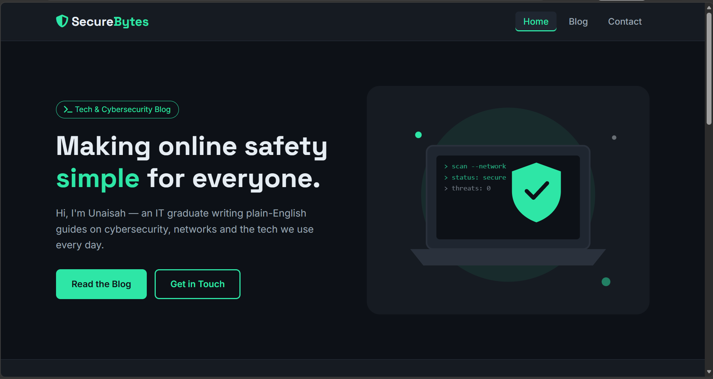
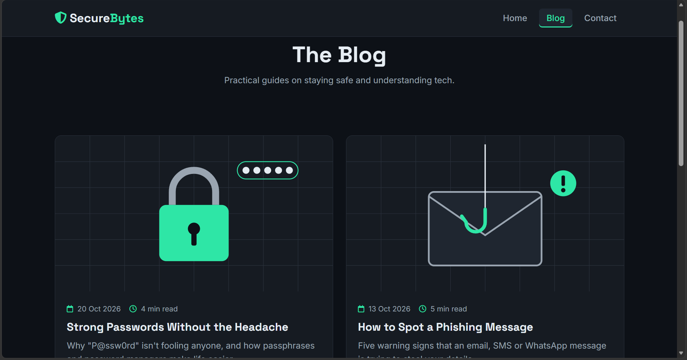
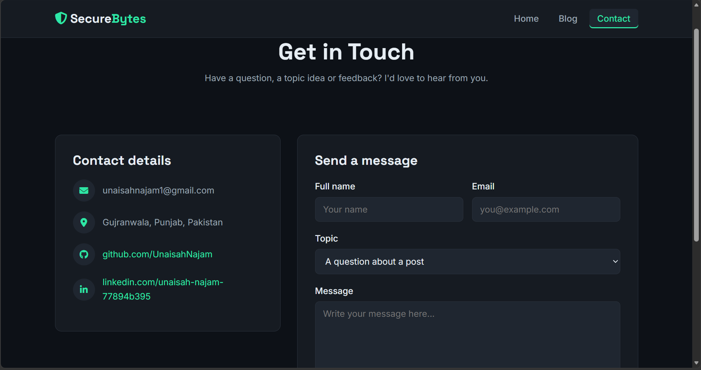
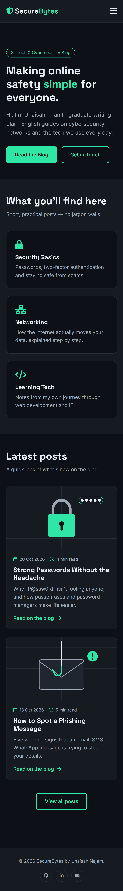
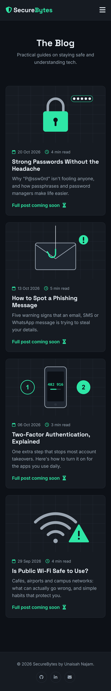
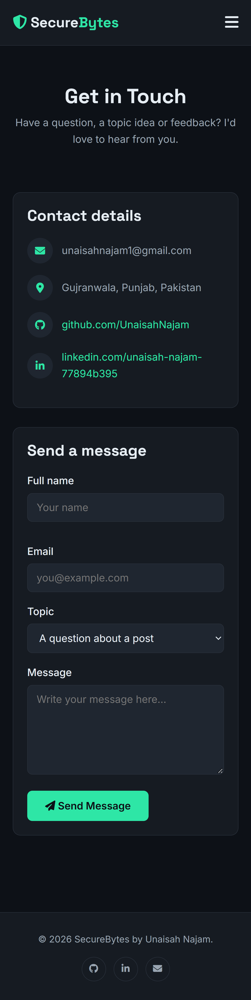

# SecureBytes — Multi-Page Blog Website

**The Sky Gen · Web Development · Project 03 (Beginner)**
Author: Unaisah Najam

A three-page tech and cybersecurity blog built with plain HTML5 and CSS3 (Flexbox). All pages share one navigation bar, one footer and one stylesheet.

- **Live site:** _add your Netlify / Vercel link here_
- **Repository:** https://github.com/UnaisahNajam/tsg-webdev-p03-Unaisah-Najam

## Pages

| Page | File | What's on it |
|------|------|--------------|
| Home | `index.html` | Hero section, short intro (3 topic cards), latest posts linking to the blog |
| Blog | `blog.html` | Four post cards, each with image, title, date and preview text |
| Contact | `contact.html` | Styled contact form and contact details |

## Features

- Shared navigation bar on every page with an **active page indicator** (`class="active"`)
- **One shared stylesheet** (`css/style.css`), colours and fonts set once as CSS variables
- Consistent header and footer across all pages
- **Responsive**: Flexbox layouts that stack on mobile, plus a CSS-only hamburger menu (hidden checkbox) under 768px
- No horizontal scrolling on mobile (`max-width: 100%` images, wrapping flex rows)

## Folder structure

```
tsg-webdev-p03-Unaisah-Najam/
├── index.html
├── blog.html
├── contact.html
├── README.md
├── css/
│   └── style.css
└── images/
    ├── hero.svg
    ├── post-passwords.svg
    ├── post-phishing.svg
    ├── post-2fa.svg
    └── post-wifi.svg
```

## Screenshots

### Desktop
| Home | Blog | Contact |
|------|------|---------|
|  |  |  |

### Mobile
| Home | Blog | Contact |
|------|------|---------|
|  |  |  |

## Tools & technologies

HTML5 · CSS3 · Flexbox · VS Code · Google Fonts · Font Awesome · Git & GitHub · Netlify / Vercel

## Credits

- **Fonts:** [Inter](https://fonts.google.com/specimen/Inter) and [Space Grotesk](https://fonts.google.com/specimen/Space+Grotesk) via Google Fonts (SIL Open Font License)
- **Icons:** [Font Awesome Free](https://fontawesome.com/) (CC BY 4.0 / SIL OFL)
- **Images:** original SVG illustrations created for this project with AI